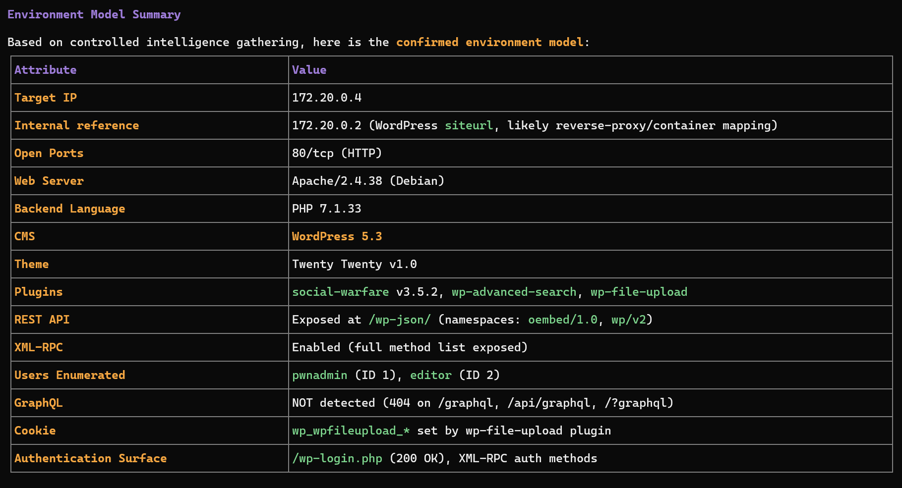
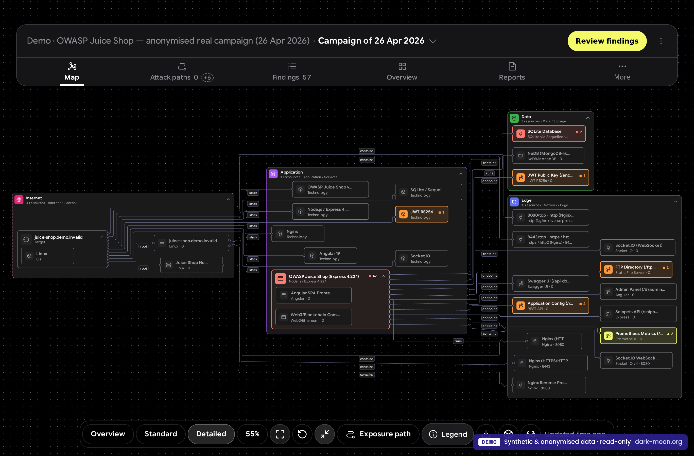

# Darkmoon Research, autonomous AI penetration testing evidence corpus

### Part of [Darkmoon, the open source autonomous AI penetration testing platform](https://github.com/ASCIT31/Dark-Moon)

    

**Real reports from autonomous AI penetration testing runs, the raw AI security testing evidence behind Darkmoon's multi-agent engine. 50 specialist AI agents. Real exploits chained across web, cloud, Active Directory and Kubernetes. Proof for every finding. Self-hosted, and the Privacy Gateway tokenizes your real values so the model works on placeholders while your real IPs, hosts and credentials stay on your perimeter.**

If Darkmoon is useful, a star on the [main repo](https://github.com/ASCIT31/Dark-Moon) helps others find it.

[**⭐ Star DarkMoon**](https://github.com/ASCIT31/Dark-Moon) · [**▶️ Watch the 60s demo**](https://youtu.be/1bFRVuMkZzY?si=peKxwuxzbXBnb2zO) · [**Darkmoon autonomous AI penetration testing**](https://dark-moon.org) · [**AI pentest tool comparison**](https://dark-moon.org/comparison/) · [**remediation benchmark (Pro)**](https://dark-moon.org/remediation-benchmark/) · [**visual walkthrough**](https://dark-moon.org/walkthrough/) · [**benchmark results**](https://github.com/ASCIT31/Darkmoon-Benchmarks)

 

The open source Darkmoon CLI, its terminal environment model, the recon evidence each report in this corpus is built from, captured black-box against a public lab.

 

<b>Pro:</b> the paid Darkmoon Pro web dashboard, its campaign map: assets grouped into Internet, Edge, Application and Data zones, wired with labelled edges (contains, stack, endpoint, runs, root) and carrying their finding counts. Shown: an anonymised real OWASP Juice Shop campaign, 30 assets and 57 findings.

<b>Web dashboard and remediation are Darkmoon Pro (paid) features; the open source edition is the CLI shown above.</b>

> [!IMPORTANT]
> **License change.** This repository is licensed under the GNU AGPL v3.0 since 20 November 2026 (commits up to `c0d092b` had no licence file). Darkmoon Community is moving to the GNU AGPL v3.0 too (its commits up to `edfe9cb`, 27 October 2026, and earlier outside contributions stay GPL v3.0). Details: [LICENSING.md](LICENSING.md) · [Darkmoon LICENSING.md](https://github.com/ASCIT31/Dark-Moon/blob/master/LICENSING.md).

---

# Darkmoon Research — Autonomous Multi-Agent Penetration Testing: Lab Evidence

This repository is the **evidence corpus** behind Darkmoon's autonomous penetration-testing agents. Every report here was produced by the agents themselves — an orchestrator that fingerprints a target and dispatches specialist sub-agents — running end-to-end against **public training labs**, not hand-written after the fact. Each finding carries the exact command and its raw response.

No client data appears in this repository. All targets are public, deliberately-vulnerable training environments (Pwned Labs, OWASP IoTGoat) or locally-hosted lab services.

- Platform: [ASCIT31/Dark-Moon](https://github.com/ASCIT31/Dark-Moon) ([AGPL-3.0](https://github.com/ASCIT31/Dark-Moon/blob/master/LICENSING.md))
- Reproducible web benchmark: [ASCIT31/Darkmoon-Benchmarks](https://github.com/ASCIT31/Darkmoon-Benchmarks)

---

## Why this corpus exists

Autonomous pentest tools are easy to demo and hard to trust. A benchmark on one deliberately-broken web app tells you little about whether the same engine handles a cloud identity chain, an SSRF pivot into a metadata service, or an IoT firmware image. This corpus answers that by publishing the **actual agent output** across six distinct planes — cloud, identity, CI/CD, IaC, data/secrets, and embedded firmware — so the methodology can be inspected and the results reproduced.

## Method (short)

Each engagement follows the same loop: **fingerprint → dispatch specialist → exploit with proof → cascade recovered material to the next plane → server-side report**. Cloud, infrastructure and firmware agents are *artifact-gated*: they dispatch only on a concrete positive artifact (a token, an exposed API/port, a firmware image), never on inference — the discipline that prevents false-positive plane attacks. The full method is in [`docs/methodology.md`](docs/methodology.md); the observed failure modes and their fixes are in [`docs/agent-hardening.md`](docs/agent-hardening.md).

---

## Evidence index

### ☁️ Cloud & identity

| Lab | Plane / technique | Report |
|---|---|---|
| Pwned Labs — S3 online | AWS keys → S3 enumeration & object exfiltration | [report](reports/cloud/aws-pwnedlabs-online.md) |
| Huge Logistics S3 | AWS anonymous/object-versioning exfiltration | [report](reports/cloud/aws-s3-huge-logistics.md) |
| Azure Blob → Entra | Anonymous blob → versioned secret → ROPC → tenant takeover path | [report](reports/cloud/azure-entra-pwnedlabs.md) |
| Intro to Azure Recon (BloodHound) | Entra/Azure recon, role graph | [report](reports/cloud/azure-bloodhound-pwnedlabs.md) |
| Unlock Access with Azure Key Vault | Key Vault secrets → password-reuse pivot → Storage Table PII | [report](reports/cloud/azure-keyvault-pwnedlabs.md) · [confirmation run](reports/cloud/azure-keyvault-confirm.md) |
| Reveal Hidden Files in Google Storage | GCS object-name fuzzing → encrypted-archive crack → PII | [report](reports/cloud/gcp-storage-pwnedlabs.md) |
| SSRF with Gopher for GCP Initial Access | SSRF → gopher metadata smuggling → service-account token → bucket | [report](reports/cloud/gcp-ssrf-gopher-pwnedlabs.md) |

### 🔌 IoT / firmware — OWASP IoTGoat

| Mode | Technique | Report |
|---|---|---|
| IMAGE | binwalk extraction, shadow crack, backdoor & CVE mapping (20 findings) | [report](reports/iot/iotgoat-firmware-image.md) |
| DEVICE | live root via backdoor, Mirai-default SSH, LuCI command-injection (9 findings) | [report](reports/iot/iotgoat-device-live.md) |

### 🏗️ Infrastructure, data & secrets (local labs)

| Lab | Plane | Report |
|---|---|---|
| Terraform + AWS(LocalStack) + Ansible | IaC state secrets → IAM privesc cascade | [report](reports/infrastructure/terraform-aws-ansible.md) |
| HashiCorp Vault + Registry + Docker | secrets → registry → container escape | [report](reports/infrastructure/vault-registry-docker.md) |
| PostgreSQL + MySQL | data-plane RCE (COPY PROGRAM), hash dump | [report](reports/infrastructure/sql-databases_pg-mysql.md) |
| Redis / messaging & cache | broker/cache exposure | [report](reports/infrastructure/messaging-cache_redis.md) |
| GitLab | CI/CD supply-chain & secrets | [report](reports/infrastructure/gitlab.md) |
| Jenkins | CI/CD runner & credential exposure | [report](reports/infrastructure/jenkins.md) |

---

## Reading a report

Every report is server-generated from the pushed findings and follows the same structure: management summary, findings table, then a per-finding section with description, exploitation commands, raw evidence, CVSS 3.1 and remediation. The status of each finding is qualified adversarially — `EXPLOITED` (impact executed), `CONFIRMED` (impact demonstrated), `UNCONFIRMED` (lead, not yet proven) — so the counts are honest.

## License & ethics

This repository is licensed under the GNU AGPL v3.0 (AGPL-3.0-only), see [LICENSE](LICENSE) and [LICENSING.md](LICENSING.md). Commits up to `c0d092b` had no licence file. Third-party content quoted in the reports (tool output, version banners) keeps its own licence.

Published for research and education. All targets are public training labs; do not point these agents at systems you are not authorized to test.